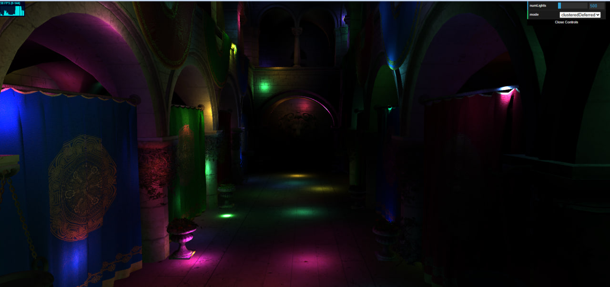
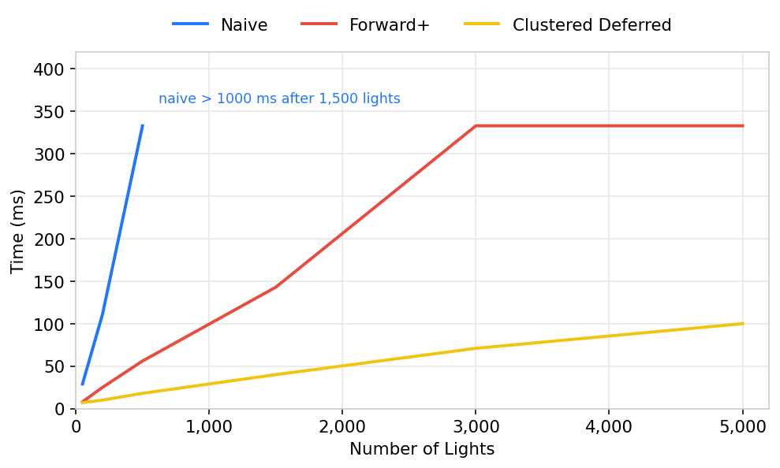

# WebGPU Forward+ and Clustered Deferred Shading

**University of Pennsylvania, CIS 5650: GPU Programming and Architecture, Project 4**

- Nikita Lopatenko
- Tested on: Google Chrome 155.0.8059.84 (64-bit) on Windows 11 Pro, Intel Core i7-13620H @ 2.40GHz, 32GB RAM, NVIDIA GeForce RTX 4070 Laptop GPU 8GB (personal laptop)

### Live Demo

### Demo Video

[Demo video](img/video.mp4)

A bit over 30 seconds. I turn the camera around the atrium, switch naive / Forward+ / clustered deferred, and drag the light count.

---

Sponza, lots of moving point lights, three modes in the GUI.

Naive checks every light on every fragment. Forward+ drops the lights into a 16×12×10 grid of clusters (slices of the camera frustum), and a fragment only loops over the lights sitting in its own cluster. Clustered deferred uses that same grid, writes albedo, normal, and world position into a G-buffer, then lights each pixel once from a fullscreen triangle.

A cluster holds at most 512 light indices. Light radius is 2, same number the attenuation function already used. I did not do the extra credit (bloom, packing the G-buffer, visibility buffer, render bundles, depth prepass).

### Performance

The little graph in the corner has two panels. FPS is frames per second. The assignment wants milliseconds, so I converted: `ms = 1000 / FPS`. At 10 FPS a frame takes 100 ms, because a second is 1000 ms. The other panel, MS, stayed at 0 the whole time. It only clocks the CPU between `begin` and `end`, and `draw()` hands the work to the GPU and returns right away. I left the camera still while writing the numbers down. Past 1500 lights, naive dropped under 1 FPS, so those three cells are just "slower than a second."

| lights | naive    | Forward+ | clustered deferred |
| ------ | -------- | -------- | ------------------ |
| 50     | 29 ms    | 8 ms     | 7 ms               |
| 200    | 111 ms   | 25 ms    | 10 ms              |
| 500    | 333 ms   | 56 ms    | 18 ms              |
| 1500   | >1000 ms | 143 ms   | 40 ms              |
| 3000   | >1000 ms | 333 ms   | 71 ms              |
| 5000   | >1000 ms | 333 ms   | 100 ms             |

Same 16×12×10 grid on every row. I did not try other tile counts.

Deferred wins once there are more than a few lights, and the gap gets bigger as the slider goes up. Naive gets worse almost in a straight line, since every fragment still walks the whole light list. Forward+ only walks the lights in that cluster, so it beats naive, but it still shades every fragment of every triangle, including stuff that is hidden behind something else. Deferred spends time writing three extra images, then lights only the pixels you can actually see. At 50 lights that extra writing eats the win: deferred and Forward+ are about tied, and 7 ms is also the 144 Hz refresh, so it might have been a bit faster than the screen could show. At 5000 lights the fullscreen pass is the cheap one.

Forward+ is 333 ms at both 3000 and 5000. A lot of the lights pile into the same clusters in the middle of the hall, the lists fill up, and the fragment loop stops getting longer. Clustering still walks every light, which is why deferred keeps creeping up over that range (71 ms, then 100 ms). I first had a cap of 128. Those full lists just dropped lights, and naive looked brighter at the same slider value because it never skips one. 512 is so a list can actually hold the overlaps in this scene. I did not keep a before/after time for that change. It was so the picture would keep the lights, not a speedup.

### Credits

- [Vite](https://vitejs.dev/)
- [loaders.gl](https://loaders.gl/)
- [dat.GUI](https://github.com/dataarts/dat.gui)
- [stats.js](https://github.com/mrdoob/stats.js)
- [wgpu-matrix](https://github.com/greggman/wgpu-matrix)

